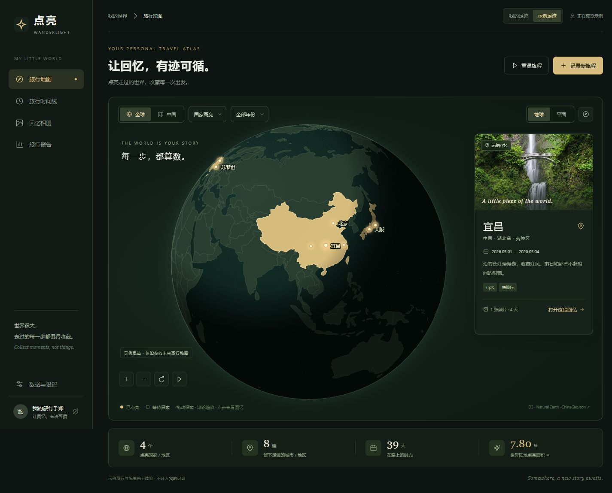

# 点亮 · Wanderlight

一个可以直接使用的个人旅行地图网页：深色旋转地球仪、暖金色点亮行政区、照片相册、旅行时间线与人生旅行报告。



## 给第一次使用的朋友

启用 GitHub Pages 后，本仓库的网页地址是 **https://badchestnuts.github.io/wanderlight/**。

1. 用电脑或手机浏览器打开网页，不需要注册账号或安装 Codex。
2. 点击右上角「我的足迹」，再点击「记录新旅程」。
3. 选择地点、旅行日期，上传至少一张照片，保存后地图就会点亮。
4. 在相册、时间线和人生报告中查看自己的记录。
5. 在「数据与设置」中导出完整备份，保留包含照片的 `.json` 文件。

你和朋友可以使用同一个网址，各自的记录保存在各自的浏览器里，不会混在一起；若共用同一个浏览器档案，则会共享这份本机记录。公开网站和源码不包含使用者后来上传的私人旅行记录与照片。

**当前没有跨设备自动同步。** 换电脑、换浏览器或换网址时，在原设备导出完整备份，再在新设备导入。清理浏览器网站数据会删除记录，建议使用普通浏览窗口并定期备份。

## 在 GitHub 上发布自己的版本

朋友也可以 Fork 本仓库，建立自己的源码副本。首次启用网页托管：

1. 打开仓库的 **Settings → Pages**。
2. 在 **Build and deployment → Source** 中选择 **GitHub Actions**。
3. 打开 **Actions → Check and publish Wanderlight → Run workflow**，运行一次。
4. 等待绿色成功状态，回到 **Settings → Pages** 复制实际显示的网站地址。

已提供 `.github/workflows/pages.yml`，通过旅行逻辑和地图文件检查后发布 `dist/`。以后更新 `main` 分支会自动发布。只有 `dist/` 中的静态文件作为网页部署。

GitHub Free 支持公开仓库的 Pages，不需要购买域名或服务器；流量和可用性仍受平台限制。详见 [GitHub Pages](https://docs.github.com/en/pages/getting-started-with-github-pages/what-is-github-pages) 和 [使用限制](https://docs.github.com/en/pages/getting-started-with-github-pages/github-pages-limits)。

## 网站运行时，资源来自哪里

| 工作 | 使用的资源 |
| --- | --- |
| 保存并发送网页和地图文件 | 网站托管平台的存储与网络流量；GitHub Pages 版本由 GitHub 托管 |
| 地球动画、地图绘制、照片压缩和旅行统计 | 访问者设备的处理器、显卡和内存 |
| 保存旅行记录与照片 | 访问者当前浏览器的本机存储 |
| 示例配图 | Unsplash 图片服务与网络流量 |
| 点击「定位城市」搜索地点 | Photon 公共搜索服务，也可用内置坐标或手动填写 |

本项目日常运行不调用 AI 模型接口，也不需要作者的电脑或 Codex 对话保持开启。托管与流量有实际成本，免费托管是平台在规定额度内提供的服务，并非资源没有消耗。

## 启动

需要 Node.js 20.11 或更新版本。无 npm 依赖，也不需要安装或申请地图 API Key。

```powershell
cd wanderlight
node scripts/serve.mjs
```

打开 http://localhost:4173。Windows 双击项目内的 `启动点亮.cmd` 也可以启动并打开浏览器。保持该服务器窗口运行即可使用；关闭窗口会停止本地服务，记录仍保留。源码包需要 Node.js，另行提供的 Windows 便携包则已附带运行程序。

`dist/` 是完整静态网页，可部署到任意静态网站托管服务。不要直接双击 HTML 文件，因为浏览器会限制本地 JSON 文件读取。

## 使用

- 首次展示明确标注的「示例足迹」，不会存入你的记录或备份。切换「我的足迹」开始自己的地图。
- 「记录新旅程」选择地点、出发和返程日期，上传至少一张照片。支持 1–12 张 JPEG/PNG/WebP 图片、标签和笔记。
- 国内地点从省、市、区县列表选择。市级地点点亮城市完整轮廓；指定区县后，区县视图只点亮明确记录的区县。
- 全球支持国家/地区高亮或仅城市光点，可以旋转地球、切换平面地图。中国视图支持省级、市级和选中城市的区县下钻。
- 相同地点可以记录多次旅行。地图合并地点，详情保留每次到访的时间与照片。
- 相册、时间线与报告均可按年份或关键词筛选。报告支持浏览器打印或保存 PDF。
- 左侧「数据与设置」或手机右上角设置按钮可导出/导入包含照片的完整 JSON 备份。相同旅行 ID 使用导入内容，其他原记录保留。
- 地球可拖动、滚轮缩放；键盘方向键移动视角，`+` / `-` 缩放，`Home` 恢复默认视角；地点光点支持键盘聚焦和回车查看。
- 「重温旅程」按时间播放足迹。「路线」是按记录时间连接城市的示意大圆线，并不是实际交通轨迹。

## 数据与精度

真实记录与压缩后的照片只保存于当前网站地址、当前浏览器的 IndexedDB。不同浏览器、设备、端口和网站地址的数据互不共享。清理浏览器数据或卸载浏览器可能使记录丢失，务必定期导出备份。此版本没有账号、云数据库或自动多设备同步。

照片最长边压缩至 1800 px、JPEG 质量 85%，上传后不会离开浏览器。备份含这些保存后的照片，原始照片请另行保存。单图原文件最多 20 MB，单次备份导入最多 100 MB、最多 2000 段记录。

世界面积：以到访国家/地区的完整陆地面积除以数据中世界陆地面积，不包含南极。中国面积：以到访市级行政区的完整面积除以中国省级边界面积之和。省级视图统计条另外显示点亮省级行政区面积；报告的国内指标始终用市级。重复行政区去重；重叠旅行日期去重。筛选某年时，跨年旅行的天数裁剪到该年份。

以上均为简化矢量边界的球面面积估算，不能理解为实际走遍这些行政区，不能用于测绘、导航或精确地理分析。未收录细分轮廓的地区保留已有粒度。例如台湾地区的数据只提供省级轮廓，省内城市/县细分不完整。境外地点暂不提供省州面状高亮，使用国家与城市光点。

境外常见城市可以用内置的大致中心坐标离线定位；其他城市可手动输入经纬度，或按「定位城市」请求 [Photon](https://github.com/komoot/photon) 公共演示服务。仅用户点击时请求，限制频率并在会话中缓存；网络服务不可用时仍可手动填写。该服务只接受地点名称查询，不发送旅行日期、照片或笔记。公共服务仅适合低频个人使用，不保证可用性；批量/多人用途应更换服务或自建实例。服务地址可在 `dist/config.json` 更改。

## 开源资源与参考

首先调研了 [visited_places](https://github.com/pfalcon/visited_places)、[TravelMap](https://github.com/marlinofdoom/TravelMap) 及 MapLibre 地球投影。采用无需地图 API 的本地矢量数据路线：

- [D3 7.9.0 / d3-geo](https://d3js.org/d3-geo)：地球与地图投影、球面面积计算，ISC。
- [topojson-client 3.1.0](https://github.com/topojson/topojson-client)：解析压缩的世界边界，ISC。
- [world-atlas 2.0.2](https://github.com/topojson/world-atlas)：Natural Earth 1:110m 世界轮廓，以 1:50m 补充小国；仓库 ISC，Natural Earth 地理数据为公有领域。
- [ChinaGeoJson](https://github.com/zhChuXiao/ChinaGeoJson)：中国市/县层级数据，仓库 MIT；原始来源 DataV.GeoAtlas。
- [China-GeoData](https://github.com/Supeset/China-GeoData)：省级边界与南海辅助线，MIT。
- [i18n-iso-countries 7.14.0](https://github.com/michaelwittig/node-i18n-iso-countries)：国家编码与中文名称，MIT。
- 示例配图来自 Unsplash，仅用于展示效果，不能视为相应地点的真实旅行摄影；用户照片不使用外部图片服务。

许可证随网页保存在 `dist/licenses/`，固定版本与数据源提交记录见 `dist/data/sources.json`。地图资源本地打包，浏览地图不请求地图瓦片。

## 验证与维护

```powershell
node --test tests/travel.test.mjs
node scripts/verify.mjs
```

测试涵盖真实宜昌/夷陵轮廓、球面绕序、重游去重、重叠日期、跨年统计、照片和备份验证、导入合并与空数据统计。刷新公开地图快照：`node scripts/refresh-data.mjs`，需要互联网；此命令不影响浏览器中的旅行记录。

## 费用与后续

本项目原创代码采用 [MIT 许可证](LICENSE)。第三方代码、地图数据和示例图片保留其原有许可和条款。

当前没有付费地图 API、数据库或云存储依赖。本地运行无需购买服务。已提供静态网页托管版本；托管账户的额度与计费以平台为准。本次未购买域名或服务。

可继续扩展账号登录、多设备实时同步、原始照片云备份、更多国家的省州边界、卫星底图。需要付费服务时应先说明实际方案和费用。
